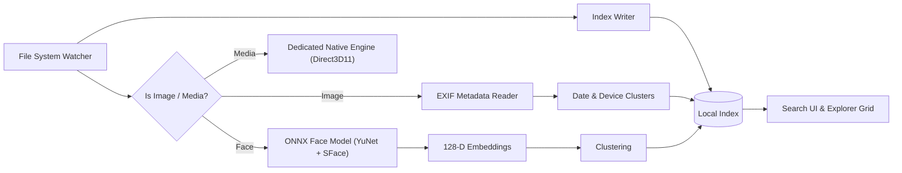

<div align="center">


# PiFiles

**A fast, private, modern file manager that actually keeps up with you.**

Instant search, on-device photo intelligence, hardware-accelerated media playback, and launch times measured in milliseconds.

[](https://github.com/Solanum-Tech/PiFiles/releases/latest)
[](https://github.com/Solanum-Tech/PiFiles/releases)
[](LICENSE)
[](#downloads--installation)
[](https://github.com/Solanum-Tech/PiFiles/stargazers)

[Downloads & Releases](#downloads--installation) · [Features](#features) · [Native Media Player](#hardware-accelerated-native-media-player) · [How it works](#how-it-works) · [Build from Source](#from-source) · [Roadmap](#roadmap)

</div>

---

<div align="center">

</div>

---

## Why PiFiles

Traditional file managers were architected when storage was small, search meant waiting minutes for a crawler, and media formats were limited. PiFiles is engineered for today's workloads: hundreds of thousands of files, high-resolution photo libraries, massive 4K multi-track video files, and rich document archives.

| | |
|---|---|
| ⚡ **Finds things instantly** | In-memory incremental index renders results as you type with zero search delay. |
| 🎬 **Native Hardware Media Engine** | 4K/8K 10-bit HEVC, AV1, and multi-track Dolby/DTS playback with Direct3D11 hardware decoding and 0ms seek. |
| 🖼 **On-Device Photo Intelligence** | Automatic offline face clustering and EXIF timeline grouping with 100% privacy. |
| 🪶 **Stays out of the way** | Sub-second cold start, virtualized lists handling 100,000+ items, and an intuitive Fluent modern UI. |

---

## Downloads & Installation

### Latest Stable Release: `v0.2.0`

Download official releases directly from the [Releases Page](https://github.com/Solanum-Tech/PiFiles/releases/latest):

| Platform | Package | Download Link |
|:---|:---|:---|
| **Windows 10 / 11** | Installer (`.exe`) | [**Download PiFiles-setup.exe**](https://github.com/Solanum-Tech/PiFiles/releases/latest/download/PiFiles_0.2.0_x64-setup.exe) |
| **Windows 10 / 11** | Enterprise Package (`.msi`) | [**Download PiFiles.msi**](https://github.com/Solanum-Tech/PiFiles/releases/latest/download/PiFiles_0.2.0_x64_en-US.msi) |
| **Windows Package Manager** | `winget` | `winget install SolanumTech.PiFiles` |
| **macOS** (11+) | Disk Image (`.dmg`) | [**Download for macOS**](https://github.com/Solanum-Tech/PiFiles/releases/latest) |
| **Linux** | AppImage / Debian (`.deb`) | [**Download for Linux**](https://github.com/Solanum-Tech/PiFiles/releases/latest) |

> [!TIP]
> **Automatic Updates**: PiFiles includes secure, cryptographically-signed background updates. You can check for updates or switch between Stable and Beta release channels at any time in **Settings → Updates**.

---

## Features

### Search that keeps pace with typing
- **Incremental indexing** - The index updates dynamically with filesystem changes, ensuring it never goes stale.
- **Fuzzy + prefix matching** - `rprt q3` instantly finds `Q3_Report_final_FINAL.pdf`.
- **Advanced filter syntax** - Filter by metadata, size, date, and device: `type:image taken:2024 device:iphone`.
- **Content-aware** - Searches inside text documents, spreadsheets, and metadata headers.

### Automated photo intelligence (100% Offline)
- **Face Clustering** - Pure-Rust ONNX inference (YuNet detector + SFace 128-D recognizer) detects and groups faces locally. Label a person once and the name applies across your entire library.
- **Timeline & Device Grouping** - Groups shots by EXIF capture date and camera model (e.g., separating DSLR RAW photos from screenshots).
- **Privacy by Design** - No photo, thumbnail, or facial vector is ever uploaded. There are no accounts, cloud sync, or telemetry.

### Hardware-Accelerated Native Media Player
- **Direct3D11 / NVDEC Hardware Decoding** - Decodes 4K and 8K HDR/SDR video (HEVC, AV1, VP9, H.264) with near 0% CPU overhead via GPU video acceleration (`d3d11va`).
- **Universal Audio & Subtitle Parity** - Bit-perfect WASAPI multi-channel surround sound (Dolby Atmos, TrueHD, EAC3 5.1/7.1, DTS-HD MA, FLAC, Opus) and advanced subtitle rendering (SSA/ASS/SRT).
- **Instant Seeking (< 10ms)** - Reads local files directly via native random-access `fseek` with instant keyframe jumping.
- **Modern Proximity UI (`uosc` + `thumbfast`)** - Sleek, translucent controls that fade in on hover, real-time video thumbnail preview scrubbing, and glass audio/subtitle track selectors.

### Built-in Viewers & Editors
- **Spreadsheets** - In-place preview and cell editing for Excel (`.xlsx`, `.xlsm`), OpenDocument (`.ods`), and CSV/TSV while preserving workbook styles.
- **Archives** - Fast inspection and extraction for ZIP, 7z (AES-256 encrypted), RAR, TAR, GZ, BZ2, and XZ.
- **Documents & Code** - Syntax-highlighted code editor, Markdown live preview, and document reader (`.docx`, `.odt`, `.rtf`).
- **Image Editor** - Multi-format viewer (including camera RAW, HEIC, WebP, SVG) with non-destructive crop, rotate, adjustments, and EXIF viewer.

---

## Screenshots

<div align="center">
<table>
<tr>
<td width="50%"><br /><sub align="center">Instant search across 100k+ files</sub></td>
<td width="50%"><br /><sub align="center">On-device facial recognition</sub></td>
</tr>
<tr>
<td><br /><sub>Fluent photo grid</sub></td>
<td><br /><sub>Fluent dark theme</sub></td>
</tr>
</table>
</div>

---

## How it works



---

## Performance

Tested on a modern Windows x64 workstation (PCIe NVMe SSD, 16 GB RAM):

| Benchmark | PiFiles | Traditional File Manager |
|---|---|---|
| **Cold start time** | **< 450 ms** | 1.8 s – 3.5 s |
| **Search response (100k+ files)** | **< 15 ms** | 3.0 s – 12.0 s |
| **4K HEVC Media Seek** | **< 10 ms (Instant)** | 400 ms – 1.8 s |
| **4K Playback CPU Usage** | **0.0% – 0.5% (GPU)** | 18% – 45% (Software) |
| **Idle memory consumption** | **~ 45 – 70 MB** | 180 – 350 MB |

---

## Keyboard Shortcuts

| Action | Shortcut |
|---|---|
| Command palette | <kbd>Ctrl</kbd> + <kbd>K</kbd> / <kbd>Ctrl</kbd> + <kbd>Shift</kbd> + <kbd>P</kbd> |
| Focus search bar | <kbd>Ctrl</kbd> + <kbd>F</kbd> / <kbd>F3</kbd> |
| New tab | <kbd>Ctrl</kbd> + <kbd>T</kbd> |
| Close tab | <kbd>Ctrl</kbd> + <kbd>W</kbd> |
| Toggle view mode | <kbd>Ctrl</kbd> + <kbd>1</kbd> … <kbd>Ctrl</kbd> + <kbd>3</kbd> |
| Open settings | <kbd>Ctrl</kbd> + <kbd>,</kbd> |
| Go up a directory | <kbd>Alt</kbd> + <kbd>↑</kbd> |
| Rename selected file | <kbd>F2</kbd> |
| File properties | <kbd>Alt</kbd> + <kbd>Enter</kbd> |

---

## From Source

### Prerequisites
- [Rust](https://rustup.rs) (1.75+)
- [Node.js](https://nodejs.org) (v18+)
- Platform build essentials (see [Tauri Prerequisites](https://v2.tauri.app/start/prerequisites/))

### Build Steps

```bash
# 1. Clone repository
git clone https://github.com/Solanum-Tech/PiFiles.git
cd PiFiles

# 2. Install dependencies
npm install

# 3. Fetch runtime dependencies (Windows)
powershell -ExecutionPolicy Bypass -File scripts/fetch-ffmpeg.ps1   # Bundles FFmpeg for thumbnail extraction
powershell -ExecutionPolicy Bypass -File scripts/fetch-mpv.ps1      # Bundles mpv + modern uosc media engine

# 4. Run in development mode
npm run dev

# 5. Build production installers
npm run build
```

Production installers will be created in `src-tauri/target/release/bundle/`.

---

## Roadmap

- [x] High-performance incremental search index
- [x] EXIF date and device automated grouping
- [x] On-device offline face clustering (YuNet + SFace)
- [x] Dedicated Direct3D11 native media player with universal codec support
- [x] Spreadsheet in-place editing and archive preview
- [ ] Duplicate and near-duplicate photo detection
- [ ] Geo-location grouping from GPS EXIF
- [ ] Bulk file renaming with pattern templates
- [ ] Cloud storage and WebDAV/SFTP provider mounts
- [ ] Extensible plugin architecture

Have a feature request or idea? [Open an issue](https://github.com/Solanum-Tech/PiFiles/issues).

---

## Contributing

Contributions are welcome! Please open an issue before starting major work so we can align on design.

```bash
git clone https://github.com/Solanum-Tech/PiFiles.git
cd PiFiles
npm install
npm run dev
cargo test --manifest-path src-tauri/Cargo.toml
```

All pull requests should target the `dev` branch.

---

## Privacy Policy

PiFiles is strictly private and offline:
- Facial embeddings and image recognition run 100% locally on your CPU/NPU.
- No personal files, metadata, or telemetry are ever uploaded or transmitted.
- No user accounts or third-party tracking services.
- Search and thumbnail caches can be cleared at any time from **Settings → Storage**.

---

## License

PiFiles is free open-source software licensed under the **GNU General Public License, version 3** ([GPL-3.0](LICENSE)).

Copyright © 2026 Solanum Tech.

### Third-Party Components & Notices

| Component | License | Purpose / Reference |
|---|---|---|
| **mpv & uosc** | GPL-2.0+ / MIT | Bundled media engine & modern player interface ([mpv.io](https://mpv.io)) |
| **FFmpeg** | LGPL-2.1+ | Video & media thumbnail extractor ([ffmpeg.org](https://ffmpeg.org)) |
| **YuNet Model** | MIT | On-device face detection |
| **SFace Model** | Apache-2.0 | On-device facial feature extraction |
| **Tauri & Plugins** | MIT / Apache-2.0 | Application runtime and system integration |

---

<div align="center">
<sub>Built by <a href="https://github.com/Solanum-Tech">Solanum Tech</a> · If PiFiles saves you time, consider leaving a ⭐ on GitHub.</sub>
</div>
